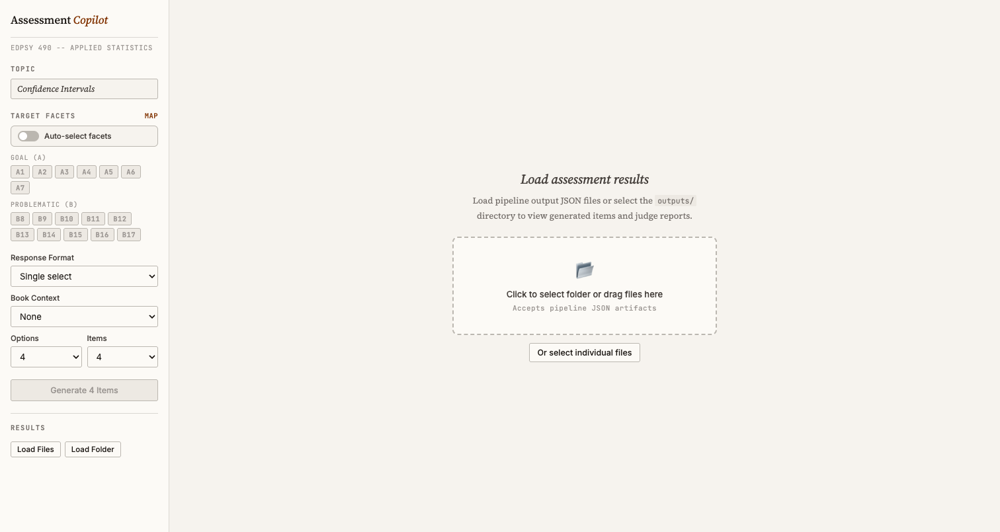
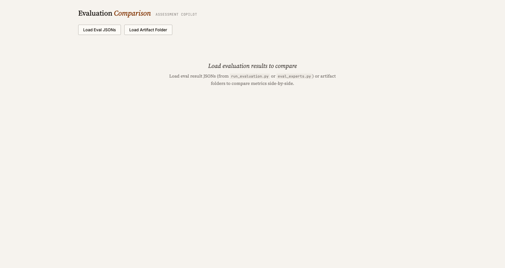

# Diagnostic Assessment Copilot

An LLM-powered pipeline for generating high-quality multiple-choice diagnostic assessment items aligned to learning goals and misconception facets. 
## What This Does

The pipeline takes a **facet map** (learning goals + common misconceptions) and generates diagnostic MC items where:
- Each correct option maps to one or more learning goals (A-facets)
- Each distractor targets a specific student misconception (B-facets)
- A separate judge LLM independently verifies facet-option alignment
- Automated rubrics evaluate correctness, naturalness, and facet embedding depth

## Quick Links for Reviewers

If you just want to look at the generated items and evaluation results:

| Document | Description |
|----------|-------------|
| [First Pass Items](docs/generated_items_first_pass_no_books.md) | 10 items generated with V1 prompt (single-select only) |
| [Second Pass Items](docs/generated_items_second_pass_no_books.md) | 10 items generated with V2 prompt — latent-facet design (single-select only) |
| [Third Pass Items](docs/generated_items_third_pass_no_books.md) | 10 items generated with V2 prompt — dynamic format (model chooses format) |
| [Third Pass + EDPSY Book](docs/generated_items_third_pass_with_edpsy.md) | 10 items generated with V2 prompt + textbook context (Gemini 3 Flash) |
| [Third Pass — Sonnet 4.6](docs/generated_items_third_pass_sonnet-4-6.md) | 10 items generated with V2 prompt — dynamic format (Claude Sonnet 4.6) |
| [V3 + Figures — Gemini Flash](docs/generated_items_gemini_flash_v3_with_figures.md) | 10 items with V3 prompt — figures and LaTeX notation (Gemini 3 Flash) |
| [V3 + Figures — Sonnet 4.6](docs/generated_items_sonnet_4_6_v3_with_figures.md) | 10 items with V3 prompt — figures and LaTeX notation (Claude Sonnet 4.6) |
| [12 Items Selected For Expert Review](docs//expert_review_items.md) | 12 items generated selected from above configurations for review |
| [Rubric Comparison](docs/rubric_comparison.md) | Side-by-side comparison of evaluation metrics across all passes and generator models |
| [Rubric Definitions](docs/rubrics.md) | Detailed description of all evaluation rubrics |
| [Facet Map](workflow/facets.md) | The 17 facets (7 goals + 10 misconceptions) for confidence intervals |
| [System Design](workflow/design.md) | Full pipeline architecture, schemas, and module layout |

## Running the Web Dashboard

The web dashboard provides an interactive way to explore generated items and compare evaluation results. It runs entirely in the browser (no build step needed).

**Item Explorer** — browse generated items, judge reports, and evaluation scores:



**Evaluation Comparison** — side-by-side rubric metrics across runs:



### Prerequisites

- Python 3.11+ with a local HTTP server (or any static file server)
- A modern web browser (Chrome, Firefox, Safari, Edge)
- The `outputs/` directory with generated artifacts (JSON files)

### Steps

1. **Clone the repo and navigate to it:**
   ```bash
   git clone https://github.com/MAP-LAB-UW/education_agents.git
   cd education_agents
   ```

2. **Start a local file server from the repo root:**
   ```bash
   python3 -m http.server 8000
   ```

3. **Open the Item Explorer dashboard:**

   Navigate to [http://localhost:8000/web/index.html](http://localhost:8000/web/index.html)

   This dashboard lets you browse individual generated items with their judge reports and evaluation scores.

   **Loading data:** Click "Load Folder" and select one of the artifact directories:
   - `outputs/first_pass_no_books/` — V1 prompt, single-select
   - `outputs/second_pass_no_books/` — V2 prompt, single-select
   - `outputs/third_pass_no_books/` — V2 prompt, dynamic format (Gemini 3 Flash)
   - `outputs/first_pass_with_edpsy/` — V1 prompt with textbook context
   - `outputs/third_pass_no_books_gemini-3.1-flash-lite/` — V2 prompt (Gemini 3.1 Flash Lite)
   - `outputs/third_pass_no_books_gemini-3.1-pro/` — V2 prompt (Gemini 3.1 Pro)

   You can also drag-and-drop JSON files or folders onto the dashboard.

4. **Open the Evaluation Comparison dashboard:**

   Navigate to [http://localhost:8000/web/compare.html](http://localhost:8000/web/compare.html)

   This dashboard shows side-by-side rubric metrics across multiple runs. Load eval result JSON files:
   - `outputs/eval_first_pass.json`
   - `outputs/eval_second_pass.json`
   - `outputs/eval_third_pass.json`
   - `outputs/third_pass_no_books_gemini-3.1-flash-lite.json`
   - `outputs/third_pass_no_books_gemini-3.1-pro.json`

   Or load artifact directories directly — the dashboard will compute summary metrics from individual item files.

### Troubleshooting

- **"No valid artifact JSON files found"** — Make sure you're selecting a directory that contains `.json` artifact files (the ones with timestamps in their names), not the eval summary files.
- **Dashboard doesn't load** — The HTML files are gitignored by default. If they're missing, you may need to check them out or recreate them. The core files needed are `web/index.html`, `web/compare.html`, `web/app.jsx`, `web/compare.jsx`, and `web/mock-data.js`.
- **Browser blocks file loading** — Some browsers restrict file access from `file://` URLs. Use the Python HTTP server as described above.

## Facet Map

The current facet map covers 17 dimensions of student understanding about confidence intervals:

### Learning Goals (A-facets)
| ID | Description |
|----|-------------|
| A1 | As sample size increases, standard errors decrease and sampling distribution becomes more packed |
| A2 | As sample size increases, sampling distribution approaches normal (doesn't mirror population) |
| A3 | Mean of sampling distribution equals population mean |
| A4 | Confidence level = percentage of intervals capturing the parameter across replications |
| A5 | CI captures true population parameter, not sample statistics |
| A6 | CI width depends on confidence level; width increases as confidence level increases |
| A7 | CI width increases when standard error gets larger |

### Misconceptions (B-facets)
| ID | Description |
|----|-------------|
| B8 | Sampling distribution is the same as sample distribution |
| B9 | Sampling distribution mirrors population distribution |
| B10 | Larger samples make sampling distribution more spread out |
| B11 | Larger samples make sampling distribution closer to population distribution |
| B12 | Sampling distribution is always normal regardless of sample size |
| B13 | Mean of sampling distribution depends on sample size |
| B14 | Larger sample mean is always closer to population mean |
| B15 | CI is a probability statement about a specific interval |
| B16 | CI estimates sample statistics instead of population parameters |
| B17 | Higher confidence = more precise (shorter) interval |

## Running the Pipeline

### Setup

> **Note:** The pipeline is currently configured to use the **Gemini API** exclusively. You will need a valid `GEMINI_API_KEY` to run generation, judging, and LLM-based evaluation. Without it, the pipeline will not work.

```bash
# Create and activate conda environment
conda create -n education-env python=3.11
conda activate education-env

# Install the package
pip install -e .

# Set up API keys in .env
echo "GEMINI_API_KEY=your-key-here" > .env
```

### Generate Items

```bash
# Generate 10 items with V2 prompt, dynamic format
conda run -n education-env python scripts/run_pipeline.py \
  --topic confidence_intervals \
  --n-items 10 \
  --prompt-version v2

# Generate with specific facets and format
conda run -n education-env python scripts/run_pipeline.py \
  --topic confidence_intervals \
  --facets A4 A5 B15 B16 \
  --format true_false_per_option \
  --n-items 5

# Generate with textbook context
conda run -n education-env python scripts/run_pipeline.py \
  --topic confidence_intervals \
  --book-mode full_tex \
  --n-items 10
```

### Run Evaluation

```bash
# Evaluate a batch of generated items
conda run -n education-env python scripts/run_evaluation.py outputs/<run_dir> --out outputs/eval_results.json

# Save evaluation results
conda run -n education-env python scripts/run_evaluation.py outputs/<run_dir> \
  --out outputs/eval_results.json

# Item-level evaluation only (skip corpus metrics)
conda run -n education-env python scripts/run_evaluation.py outputs/<run_dir> \
  --skip-corpus

# Evaluate expert-authored examples
conda run -n education-env python scripts/eval_experts.py --out outputs/eval_experts.json
```

## Project Structure

```
education_agents/
├── src/education_agents/
│   ├── llm.py              # LiteLLM wrapper (swap providers via env var)
│   ├── schemas.py          # Pydantic models for items, reports, eval scores
│   ├── facets.py           # Facet map loader
│   ├── generator.py        # Item generation + facet auto-selection
│   ├── judge.py            # Independent facet-tag verification
│   ├── pipeline.py         # End-to-end orchestration
│   ├── evaluation/         # Rubric implementations
│   └── prompts/            # Generator (V1, V2) and judge prompt templates
├── scripts/
│   ├── run_pipeline.py     # CLI for generation
│   └── run_evaluation.py   # CLI for evaluation
├── web/
│   ├── index.html          # Item explorer dashboard
│   ├── compare.html        # Evaluation comparison dashboard
│   ├── app.jsx             # Item explorer React app
│   ├── compare.jsx         # Comparison React app
│   └── mock-data.js        # Static facet map for dashboards
├── data/facets/            # Facet map definitions
├── outputs/                # Generated artifacts and eval results
├── docs/                   # Rubric docs and generated item markdowns
└── workflow/               # Design docs, facet definitions, project goals
```

## Models Used

| Role | Default Model |
|------|---------------|
| Generator | `gemini/gemini-3-flash-preview` |
| Judge | `gemini/gemini-3.1-pro-preview` |
| Evaluation (LLM rubrics) | `gemini/gemini-3.1-pro-preview` |
| Evaluation (embeddings) | `Qwen/Qwen3-Embedding-0.6B` |
