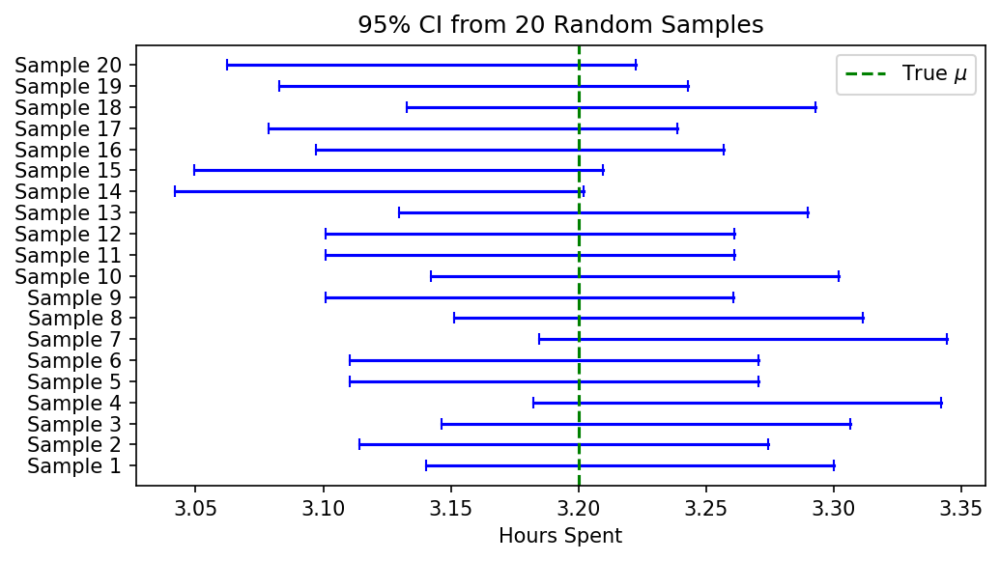
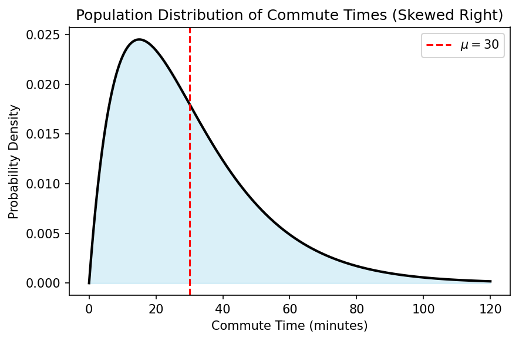
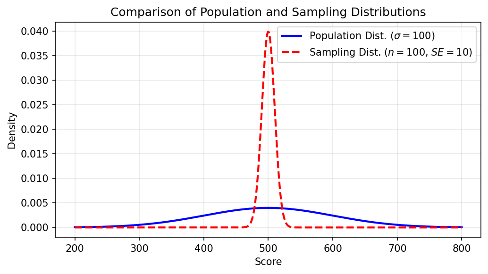

# Selected Items for Expert Review

**Topic:** Confidence Intervals  
**Items:** 12 (selected from multiple generation runs)  
**Date:** 2026-05-22  

Items were selected based on facet latency scores (higher latency = facets more deeply embedded in the scenario rather than surface paraphrases of facet definitions).

| # | Generator | Prompt | Format | Target Facets | Facet Latency |
|---|-----------|--------|--------|---------------|---------------|
| 1 | Claude Sonnet 4.6 | V3 prompt | Single Select | A1, A2, B9, B10 | 0.490 |
| 2 | Claude Sonnet 4.6 | V3 prompt | Single Select | A2, A3, B11, B12 | 0.502 |
| 3 | Claude Sonnet 4.6 | V3 prompt | True/False Per Option | A4, A5, B15, B16 | 0.506 |
| 4 | Claude Sonnet 4.6 | V3 prompt | True/False Per Option | A4, A6, B15, B17 | 0.559 |
| 5 | Gemini 3 Flash | V3 prompt | Single Select | A5, A7, B8, B9 | 0.429 |
| 6 | Gemini 3 Flash | V3 prompt | True/False Per Option | A4, A5, B15, B16 | 0.507 |
| 7 | Gemini 3 Flash | V3 prompt | Single Select | A1, A2, B10, B11 | 0.507 |
| 8 | Gemini 3 Flash | V2 prompt + EDPSY book | True/False Per Option | A5, A7, B8, B11 | 0.477 |
| 9 | Gemini 3 Flash | V2 prompt + EDPSY book | True/False Per Option | A4, A5, B15, B16 | 0.535 |
| 10 | Gemini 3 Flash | V2 prompt + EDPSY book | Single Select | A6, A7, B16, B17 | 0.553 |
| 11 | Gemini 3 Flash | V3 prompt | Single Select | A3, B8, B9, B13 | 0.587 |
| 12 | Gemini 3 Flash | V2 prompt + EDPSY book | True/False Per Option | A6, A7, B14, B15 | 0.614 |

### Item Provenance

| # | Source Directory | Artifact File | Generator Model | Prompt Version |
|---|-----------------|---------------|-----------------|----------------|
| 1 | `outputs/sonnet-4-6-prompt-with-images` | `20260522T085925_8f63d848.json` | `anthropic/claude-sonnet-4-6` | V3 |
| 2 | `outputs/sonnet-4-6-prompt-with-images` | `20260522T091243_ec3dfff9.json` | `anthropic/claude-sonnet-4-6` | V3 |
| 3 | `outputs/sonnet-4-6-prompt-with-images` | `20260522T085811_00433f63.json` | `anthropic/claude-sonnet-4-6` | V3 |
| 4 | `outputs/sonnet-4-6-prompt-with-images` | `20260522T091326_eb7bbf4a.json` | `anthropic/claude-sonnet-4-6` | V3 |
| 5 | `outputs/gemini-flash-prompt-with-images` | `20260522T085801_118dd033.json` | `gemini/gemini-3-flash-preview` | V3 |
| 6 | `outputs/gemini-flash-prompt-with-images` | `20260522T084711_44065c55.json` | `gemini/gemini-3-flash-preview` | V3 |
| 7 | `outputs/gemini-flash-prompt-with-images` | `20260522T084751_1e68e314.json` | `gemini/gemini-3-flash-preview` | V3 |
| 8 | `outputs/third_pass_with_edpsy` | `20260522T084542_dc11cf86.json` | `gemini/gemini-3-flash-preview` | V2 |
| 9 | `outputs/third_pass_with_edpsy` | `20260522T084214_c3d780d5.json` | `gemini/gemini-3-flash-preview` | V2 |
| 10 | `outputs/third_pass_with_edpsy` | `20260522T084040_512e2733.json` | `gemini/gemini-3-flash-preview` | V2 |
| 11 | `outputs/gemini-flash-prompt-with-images` | `20260522T084837_45daae9f.json` | `gemini/gemini-3-flash-preview` | V3 |
| 12 | `outputs/third_pass_with_edpsy` | `20260522T084947_a589d8d5.json` | `gemini/gemini-3-flash-preview` | V2 |

---

## Item 1

**Generator:** Claude Sonnet 4.6, V3 prompt  
**Target facets:** A1, A2, B9, B10  
**Format:** Single Select  

> **Facet selection reasoning:** These four facets cluster around a coherent conceptual theme: how sample size affects the shape and spread of the sampling distribution. A1 (larger n → smaller SE, more packed distribution) and A2 (larger n → closer to normal, not mirroring population) represent the correct understandings, while B9 (sampling distribution mirrors population distribution, so spread stays constant regardless of n) and B10 (larger n → more spread out) are the two classic opposing misconceptions. An item stem can present a scenario where sample size is increased and ask what happens to the sampling distribution, naturally discriminating among students who hold these different beliefs. This combination has not been used in prior items and covers important under-tested facets about the Central Limit Theorem and standard error.

### Stem

A population of exam scores is strongly right-skewed with mean $\mu = 72$ and standard deviation $\sigma = 15$. A researcher draws repeated random samples of size $n = 100$ from this population and records the sample mean each time.

The figure below shows four proposed descriptions of the resulting sampling distribution of $\bar{x}$. Which one is correct?

### Options

**A.** Right-skewed with mean $72$ and standard deviation $15$  
*Facets: B9, B11*  
*Rationale: A student who believes the sampling distribution mirrors the population distribution would choose this option. They preserve both the shape (right-skewed) and the standard deviation ($\sigma = 15$) from the population, ignoring how repeated sampling and the Central Limit Theorem transform the distribution.*

**B.** Right-skewed with mean $72$ and standard deviation $\frac{15}{\sqrt{100}} = 1.5$  
*Facets: B9, B10*  
*Rationale: A student who correctly computes the standard error ($\frac{\sigma}{\sqrt{n}} = 1.5$) but still thinks the shape of the sampling distribution mirrors the population would pick this. They understand sample size reduces spread (A1) but do not understand the CLT's effect on shape (B9 regarding shape, misconception akin to B11).*

**C.** Approximately normal with mean $72$ and standard deviation $\frac{15}{\sqrt{100}} = 1.5$ :white_check_mark:  
*Facets: A1, A2, A3*  
*Rationale: This is correct. With $n = 100 \geq 30$, the Central Limit Theorem guarantees the sampling distribution is approximately normal regardless of the population's skewed shape (A2). The mean of the sampling distribution equals the population mean $\mu = 72$ (A3), and the standard error is $\frac{\sigma}{\sqrt{n}} = \frac{15}{\sqrt{100}} = 1.5$, which is smaller than the population standard deviation (A1).*

**D.** Approximately normal with mean $72$ and standard deviation $15$  
*Facets: A2, B9*  
*Rationale: A student who knows that the CLT makes the sampling distribution approximately normal (A2) but incorrectly believes the spread stays the same as the population would choose this. They carry over the population standard deviation $\sigma = 15$ instead of computing the standard error, reflecting the misconception that the sampling distribution's variability is unchanged (B9, B10 in the sense of not understanding how $n$ reduces spread).*

### Explanation

This item targets four facets simultaneously through a concrete numerical scenario. Facet A1 (standard error decreases with larger $n$) is probed by contrasting options with $\sigma = 15$ versus $SE = 1.5$: students who pick options A or D fail to apply $SE = \frac{\sigma}{\sqrt{n}}$. Facet A2 (sampling distribution approaches normality, not population shape) is probed by contrasting right-skewed options (A, B) with approximately normal options (C, D): students who pick A or B believe the skewed population shape is preserved in the sampling distribution. Facet B9 (sampling distribution mirrors population distribution) manifests in options A and D, where either the shape or the standard deviation — or both — match the population. Facet B10 (larger sample size spreads out the sampling distribution) is implicitly countered by option C, where larger $n$ produces a tighter distribution ($SE = 1.5 < 15$); students who intuit larger samples mean more spread might resist the correct answer. Together the four options form a $2 \times 2$ grid crossing shape (skewed vs. normal) and spread ($\sigma$ vs. $SE$), making each option diagnostic of a specific combination of understandings and misconceptions.

---

## Item 2

**Generator:** Claude Sonnet 4.6, V3 prompt  
**Target facets:** A2, A3, B11, B12  
**Format:** Single Select  

> **Facet selection reasoning:** This combination focuses on the shape and center of the sampling distribution, which are conceptually linked but distinct ideas. A2 (sampling distribution approaches normality as n increases, not population shape) and B12 (misconception that it's always normal regardless of n or population shape) contrast the correct understanding of the Central Limit Theorem with a common over-generalization. A3 (mean of sampling distribution equals population mean) and B11 (misconception that larger samples make the sampling distribution closer to the population distribution in shape) add the center-of-distribution concept and a related shape misconception. Together these facets allow a single item stem to probe whether students truly understand what the CLT says about shape versus what stays constant (the mean), distinguishing nuanced correct knowledge from two distinct but related misconceptions. This combination has not been used in prior items.

### Stem

A researcher studies the reaction times of adults in a population that is **strongly right-skewed** with mean $\mu = 320$ ms and standard deviation $\sigma = 80$ ms. The researcher draws a random sample of $n = 64$ adults and computes the sample mean $\bar{x}$.

Which of the following correctly describes the sampling distribution of $\bar{x}$?

### Options

**A.** Approximately normal with mean $320$ ms and standard deviation $\frac{80}{\sqrt{64}} = 10$ ms :white_check_mark:  
*Facets: A2, A3*  
*Rationale: The student correctly applies the Central Limit Theorem: with $n = 64$ (large enough), the sampling distribution of $\bar{x}$ is approximately normal regardless of the population's skewed shape. They also correctly identify that the mean of the sampling distribution equals $\mu = 320$ ms and the standard error equals $\sigma/\sqrt{n} = 10$ ms.*

**B.** Strongly right-skewed with mean $320$ ms and standard deviation $\frac{80}{\sqrt{64}} = 10$ ms  
*Facets: B11*  
*Rationale: A student who believes the sampling distribution mirrors the population distribution in shape would choose this option. They correctly compute the standard error but incorrectly believe the sampling distribution inherits the right-skewed shape of the population, reflecting the misconception that a larger sample makes the sampling distribution look more like the population (B11).*

**C.** Approximately normal with mean $320$ ms and standard deviation $80$ ms  
*Facets: A2, B9*  
*Rationale: A student who knows the CLT produces a normal shape (A2) but confuses the standard deviation of the sampling distribution with the population standard deviation $\sigma$ would select this. They fail to divide by $\sqrt{n}$, believing the spread of the sampling distribution is the same as the population spread.*

**D.** Approximately normal with mean $320$ ms and standard deviation $80$ ms, because the population is large  
*Facets: B12*  
*Rationale: A student who believes the sampling distribution is always normal regardless of sample size or population shape (B12) might select this and attribute normality to population size rather than the Central Limit Theorem applying due to sufficient sample size. They also fail to correctly apply the standard error formula.*

**E.** Strongly right-skewed with mean $320$ ms and standard deviation $80$ ms  
*Facets: B9, B11, B12*  
*Rationale: A student who thinks the sampling distribution always mirrors the population distribution in both shape and spread would choose this. They conflate the sampling distribution with the population distribution entirely, showing misconceptions about both the shape (B11) and the spread (B9) of the sampling distribution.*

### Explanation

This item targets four facets. A student who correctly understands the Central Limit Theorem (A2) knows that for a large enough sample ($n = 64$), the sampling distribution of $\bar{x}$ is approximately normal even when the population is strongly right-skewed — the sampling distribution does NOT mirror the population shape. A student who understands (A3) knows the mean of the sampling distribution equals the population mean $\mu = 320$ ms. Distractors expose misconceptions: option B targets B11 (sampling distribution mirrors population shape), option C targets the belief that the SD of the sampling distribution equals the population SD (B9), and option D targets B12 (always normal regardless of conditions). Option E combines B9, B11, and B12 for students with the deepest confusion between population and sampling distributions.

---

## Item 3

**Generator:** Claude Sonnet 4.6, V3 prompt  
**Target facets:** A4, A5, B15, B16  
**Format:** True/False Per Option  

> **Facet selection reasoning:** This combination targets the interpretation of confidence intervals, a conceptually rich area that hasn't been covered in the previous item. A4 (correct interpretation of confidence level as a long-run frequency across replications) and A5 (CI captures population parameter, not sample statistics) are paired with B15 (misinterpreting CI as a probability statement about a single interval containing the mean) and B16 (thinking CI estimates sample statistics or sample data rather than population parameters). These four facets are tightly related—they all revolve around what a confidence interval actually means and what it is estimating—making it natural to craft a single item stem that distinguishes correct understanding from common misconceptions about CI interpretation.

### Stem

A nutritionist takes a random sample of $n = 40$ adults and measures their daily sugar intake. From this sample, she computes $\bar{x} = 82$ grams and constructs the following 90% confidence interval for the mean daily sugar intake of all adults in the population:
$$( 76.4, \ 87.6 )$$
For each of the following statements about this confidence interval, decide whether it is **True** or **False**.

### Options

**A.** We are 90% confident that the true mean daily sugar intake of all adults in the population is between $76.4$ and $87.6$ grams. :white_check_mark:  
*Facets: A4, A5*  
*Rationale: This is the correct interpretation. 'We are 90% confident' correctly expresses the confidence level as a long-run frequency property of the procedure (A4), and the interval targets the true population mean $\mu$, not a sample statistic (A5).*

**B.** There is a 90% probability that the true mean daily sugar intake of all adults is between $76.4$ and $87.6$ grams.  
*Facets: B15*  
*Rationale: This statement treats the confidence interval as a probability statement about the fixed (but unknown) population parameter $\mu$. Once the interval is constructed, $\mu$ is either inside or outside it — the probability is not 0.90. A student who selects 'True' here is treating the confidence level as a direct probability that this specific interval contains $\mu$ (B15).*

**C.** If we repeatedly took samples of $n = 40$ adults and constructed 90% confidence intervals the same way, about 90% of those intervals would contain the true population mean. :white_check_mark:  
*Facets: A4, A5*  
*Rationale: This is the correct long-run frequency interpretation of a 90% confidence level (A4). It correctly identifies the target as the true population mean (A5). Students who understand both facets should mark this True.*

**D.** We are 90% confident that the mean daily sugar intake of the 40 adults in the sample is between $76.4$ and $87.6$ grams.  
*Facets: A4, B16*  
*Rationale: The sample mean $\bar{x} = 82$ is a known value computed directly from the data — it is already known with certainty and does not need to be estimated. Saying the CI captures the sample mean confuses the target of inference: CIs are built to capture the unknown population parameter $\mu$, not the observed sample statistic (B16). A student marking this True is misidentifying what the interval estimates.*

**E.** 90% of all adults in the population consume between $76.4$ and $87.6$ grams of sugar per day.  
*Facets: B15, B16*  
*Rationale: This statement misidentifies the CI as capturing individual data values in the population rather than the population mean $\mu$ (B16). It also misreads the confidence level as a statement about what proportion of individuals fall inside the interval (B15). A student selecting 'True' here conflates a confidence interval with a reference range for individual observations.*

**F.** Of 100 confidence intervals constructed using this same method, we would expect approximately 90 of them to contain $\bar{x} = 82$ grams.  
*Facets: A4, B16*  
*Rationale: This option correctly invokes the repeated-sampling interpretation of the confidence level (A4 surface language) but directs it at the wrong target: the sample mean $\bar{x}$ rather than the population mean $\mu$ (B16). The sample mean is not what CI procedures try to capture across replications; the population mean is. A student who marks this True understands the long-run frequency idea but misidentifies the estimand.*

### Explanation

This item diagnoses four facets simultaneously through a concrete 90% CI scenario. Options A and C are both correct and require students to recognize (1) that the confidence level describes a long-run frequency property of the procedure (A4) and (2) that the interval targets the unknown population mean $\mu$, not any sample statistic (A5). Option B targets B15 — the common misconception that the confidence level is a direct probability that this specific realized interval contains the parameter. Options D and F target B16 — the misconception that a CI estimates the sample mean rather than the population mean — while option F also probes whether students can catch a subtle misuse of the correct repeated-sampling language. Option E targets both B15 and B16 simultaneously, representing the misconception that the CI describes a frequency of individual-level data rather than a parameter estimate.

---

## Item 4

**Generator:** Claude Sonnet 4.6, V3 prompt  
**Target facets:** A4, A6, B15, B17  
**Format:** True/False Per Option  

> **Facet selection reasoning:** This combination focuses on the interplay between confidence level interpretation and CI width. A4 (correct interpretation of confidence level as long-run frequency) and A6 (higher confidence level → wider CI) contrast directly with B15 (misinterpreting CI as a probability statement) and B17 (believing higher confidence yields a more precise/shorter interval). Together they form a coherent item that probes whether students understand both what confidence level means AND its directional effect on interval width — a novel pairing not yet used in the batch.

### Stem

A nutritionist is studying daily sugar intake among adults. After collecting a random sample of $n = 50$ adults and measuring their daily sugar intake (in grams), she computes the following 90% confidence interval for the population mean daily sugar intake: $(42.3, 57.7)$ grams.

For each of the following statements about this confidence interval, indicate whether it is **True** or **False**.

### Options

**A.** There is a 90% probability that the true mean daily sugar intake $\mu$ falls between $42.3$ and $57.7$ grams.  
*Facets: B15*  
*Rationale: A student who treats confidence level as a post-hoc probability about a fixed (but unknown) parameter will mark this True. In reality, $\mu$ is a fixed value — it either is or is not in this particular interval. The 90% refers to the long-run behavior of the procedure, not the probability that this specific interval contains $\mu$.*

**B.** If the nutritionist repeated this study many times and constructed a 90% CI each time, about 90% of those intervals would contain the true mean $\mu$. :white_check_mark:  
*Facets: A4*  
*Rationale: This is the correct frequentist interpretation of confidence level: in the long run, 90% of all intervals produced by this procedure will capture the true population mean. A student who understands A4 will recognize this as a valid replication-based interpretation.*

**C.** There is a 90% probability that a randomly selected adult's daily sugar intake falls between $42.3$ and $57.7$ grams.  
*Facets: B15, B16*  
*Rationale: A student confusing confidence level with a probability about individual data values (rather than the population mean) would mark this True. This conflates the CI for a population mean with a prediction interval for individual observations, and also misreads the 90% as a direct probability statement.*

**D.** To obtain a more precise (narrower) interval, the nutritionist should switch to a 95% confidence level while keeping $n = 50$.  
*Facets: A6, B17*  
*Rationale: A student holding the B17 misconception — that higher confidence means more precision — will mark this True. In fact, increasing the confidence level from 90% to 95% requires a larger critical value $z^*$, which widens the interval, not narrows it. This directly contradicts A6, which states that CI width increases with confidence level.*

**E.** To obtain a narrower interval than $(42.3, 57.7)$, the nutritionist could decrease the confidence level to 80% while keeping $n = 50$. :white_check_mark:  
*Facets: A6*  
*Rationale: A student who understands A6 knows that CI width depends on the critical value $z^*$, and a lower confidence level corresponds to a smaller $z^*$, producing a narrower interval. Decreasing from 90% to 80% confidence would indeed yield a shorter interval at the same sample size.*

### Explanation

This item targets four facets. **B15** is probed by option A (and also option C): students who interpret the confidence level as a direct probability that the parameter lies in *this specific* interval hold a common misconception — the 90% is a property of the long-run procedure, not a posterior probability for one realized interval. **A4** is probed by option B, the canonical correct interpretation: about 90% of intervals constructed by replication of this procedure would capture $\mu$. **B16** is probed alongside B15 in option C, where the interval is misread as covering individual observations. **A6** and **B17** are jointly probed by options D and E: option D targets B17 (the false belief that higher confidence = more precision/shorter interval), while option E rewards A6 understanding (that lower confidence level yields a narrower interval via a smaller critical value $z^*$).

---

## Item 5

**Generator:** Gemini 3 Flash, V3 prompt  
**Target facets:** A5, A7, B8, B9  
**Format:** Single Select  

> **Facet selection reasoning:** This combination of facets focuses on the foundational concept of what a confidence interval is designed to estimate (population parameters versus sample or population data) and the structural factors that determine its width. By pairing goal facets A5 and A7 with problematic facets B8 and B9, the item can diagnose whether a student's difficulty in calculating or interpreting CI width is rooted in a fundamental confusion between the sample distribution, the population distribution, and the sampling distribution.

### Stem

A soil scientist is measuring the soil acidity (pH) of a nature reserve. From previous large-scale studies, the population standard deviation of soil pH in this region is known to be $\sigma = 0.60$. The scientist takes a random sample of $n = 36$ soil cores and finds a sample mean $\bar{x} = 6.5$. They wish to construct a 95% confidence interval using the formula $\bar{x} \pm 1.96 \cdot SE$. The relationship between the population distribution and the sampling distribution is shown below: Which of the following is the correct calculation of the 95% confidence interval and its interpretation?

### Options

**A.** Using $SE = \frac{0.60}{\sqrt{36}} = 0.10$, the interval is $(6.304, 6.696)$. This interval provides an estimate for the true population mean pH of the nature reserve. :white_check_mark:  
*Facets: A5, A7*  
*Rationale: The student correctly applies the standard error formula ($SE = \sigma/\sqrt{n}$) which leads to a narrower interval than the population spread, and they correctly identify that the confidence interval is used to estimate the population parameter (mean pH).*

**B.** Using $SE = 0.60$, the interval is $(5.324, 7.676)$. This interval provides an estimate for the true population mean pH of the nature reserve.  
*Facets: A5, B9*  
*Rationale: The student correctly identifies the population mean as the target for the confidence interval (A5), but they mistakenly assume the sampling distribution has the same standard deviation as the population, ignoring the effect of sample size on the precision of the estimate (B9).*

**C.** Using $SE = \frac{0.60}{\sqrt{36}} = 0.10$, the interval is $(6.304, 6.696)$. This interval indicates that 95% of the soil cores in the current sample have a pH between $6.304$ and $6.696$.  
*Facets: A7, B8*  
*Rationale: The student correctly calculates the standard error and resulting interval width (A7), but they misinterpret the confidence interval as a description of the sample data distribution (where individual observations fall) rather than an estimate for the population parameter (B8).*

**D.** Using $SE = 0.60$, the interval is $(5.324, 7.676)$. This interval indicates that 95% of the soil cores in the current sample have a pH between $5.324$ and $7.676$.  
*Facets: B8, B9*  
*Rationale: This choice reveals two misconceptions: the student uses the population standard deviation instead of the standard error (B9) and interprets the resulting interval as the range containing the majority of individual sample data points (B8).*

### Explanation

The core objective of a confidence interval is to estimate a population parameter, such as the true mean $\mu$ (A5). To do this accurately, one must use the standard error of the sampling distribution, $SE = \sigma / \sqrt{n}$, which accounts for the fact that the distribution of sample means is less variable (more packed) than the population distribution (A7). Students who confuse the sampling distribution with the population distribution (B9) or the sample distribution (B8) will fail to correctly identify the width or the purpose of the interval.

---

## Item 6

**Generator:** Gemini 3 Flash, V3 prompt  
**Target facets:** A4, A5, B15, B16  
**Format:** True/False Per Option  

> **Facet selection reasoning:** This selection targets the conceptual interpretation of confidence intervals. It contrasts the correct interpretation of the confidence level as a frequentist long-run proportion (A4) with the common probability misconception (B15). It also addresses the target of the interval, ensuring students understand that CIs are used to estimate population parameters (A5) rather than sample statistics or specific data points (B16).

### Stem

A researcher studying social media habits finds that for a random sample of $n = 150$ high school students, the mean daily usage is $\bar{x} = 3.2$ hours. They calculate a $95\%$ confidence interval for the population mean daily usage ($\mu$) as $(2.9, 3.5)$ hours. Figure illustrates the concept of confidence intervals by showing $20$ simulated intervals calculated from different samples from the same population. Based on this study, evaluate each of the following interpretations.

### Options

**opt1.** There is a $95\%$ probability that the true population mean ($\mu$) is between $2.9$ and $3.5$ hours.  
*Facets: B15*  
*Rationale: This is a common misconception where students interpret a specific, already-calculated confidence interval as a probability statement about a fixed population parameter. In frequentist statistics, the population mean is a fixed value, so the probability that it falls within a specific range is either 0 or 1.*

**opt2.** We are $95\%$ confident that the true population mean ($\mu$) for all high school students is between $2.9$ and $3.5$ hours. :white_check_mark:  
*Facets: A4, A5*  
*Rationale: This is a correct interpretation of a confidence interval. It uses the appropriate level of confidence to describe our uncertainty about the true population parameter based on the sample data.*

**opt3.** In the long run, if we were to take many random samples of $n = 150$ and calculate a $95\%$ confidence interval for each, about $95\%$ of those intervals would contain the true population mean ($\mu$). :white_check_mark:  
*Facets: A4, A5*  
*Rationale: This correctly describes the frequentist definition of the confidence level as a 'capture rate' over infinite replications of the sampling process.*

**opt4.** Approximately $95\%$ of the high school students in the entire population spend between $2.9$ and $3.5$ hours on social media.  
*Facets: B16*  
*Rationale: This incorrectly interprets the confidence interval for the mean as a range that contains a specific percentage of individual observations in the population. Confidence intervals describe the precision of the estimate for the mean, not the distribution of the individual data points.*

**opt5.** There is a $95\%$ probability that the mean of another random sample of $150$ students will be between $2.9$ and $3.5$ hours.  
*Facets: B15, B16*  
*Rationale: This conflates a confidence interval (which estimates a population parameter) with a prediction interval for future sample statistics (B16), while also applying the probability misconception (B15).*

### Explanation

This item tests the fundamental understanding and common misinterpretations of confidence intervals. Correct interpretations (A4, A5) focus on the long-run capture rate of the population parameter (the mean $\mu$). Common errors include treating the calculated interval as a probability (B15), or confusing the population mean with individual data points or future sample statistics (B16).

---

## Item 7

**Generator:** Gemini 3 Flash, V3 prompt  
**Target facets:** A1, A2, B10, B11  
**Format:** Single Select  

> **Facet selection reasoning:** This combination targets students' conceptual understanding of the Central Limit Theorem and the effect of sample size on the sampling distribution. It contrasts the correct principles that an increased sample size decreases standard error and leads to a more normal shape (A1, A2) against the common misconceptions that larger samples cause the sampling distribution to become more spread out (B10) or to look more like the population distribution itself (B11).

### Stem

The daily commute times for all residents in a large metropolitan area are heavily skewed to the right, with a population mean $\mu = 30$ minutes and a population standard deviation $\sigma = 15$ minutes. The population distribution is shown below: A researcher plans to take many random samples of size $n = 5$ and many random samples of size $n = 100$. How will the sampling distribution of the sample mean ($\bar{x}$) for $n = 100$ compare to the sampling distribution of the sample mean for $n = 5$?

### Options

**opt1.** The distribution for $n = 100$ will be more approximately Normal in shape and the sample means will be more tightly clustered around $\mu = 30$ minutes. :white_check_mark:  
*Facets: A1, A2*  
*Rationale: This correctly applies the Central Limit Theorem: as $n$ increases, the sampling distribution of the mean becomes more Normal (A2) and the standard error ($\%sigma/\sqrt{n}$) decreases, making the distribution more concentrated (A1).*

**opt2.** The distribution for $n = 100$ will be more approximately Normal in shape, but the sample means will be more spread out over a larger range of values than for $n = 5$.  
*Facets: A2, B10*  
*Rationale: The student correctly identifies the change in shape towards Normality (A2) but incorrectly believes that a larger sample size leads to more variation in the sample mean (B10).*

**opt3.** The distribution for $n = 100$ will be more heavily skewed to the right than for $n = 5$, more closely resembling the shape of the original population distribution.  
*Facets: B11*  
*Rationale: The student confuses the sampling distribution of the mean with the distribution of individual data points in a single sample, mistakenly believing that the sampling distribution approaches the population shape as $n$ increases (B11).*

**opt4.** The distribution for $n = 100$ will look more like the skewed population distribution and will have a wider range of possible $\bar{x}$ values than the distribution for $n = 5$.  
*Facets: B10, B11*  
*Rationale: The student exhibits two misconceptions: that the sampling distribution mirrors the population shape (B11) and that larger samples result in more spread-out sampling distributions (B10).*

### Explanation

This item assesses the Central Limit Theorem's implications for sampling distributions. As sample size ($n$) increases, the Central Limit Theorem states that the sampling distribution of the sample mean ($ar{x}$) becomes more approximately Normal (A2) regardless of the population shape (as long as it has a finite variance). Additionally, the standard error of the mean is calculated as $\frac{\sigma}{\sqrt{n}}$; therefore, as $n$ increases, the standard error decreases, meaning the sampling distribution becomes more concentrated (A1). Students who miss these points often confuse the sampling distribution with the population distribution (B11) or misunderstand the relationship between sample size and the stability (variance) of the mean (B10).

---

## Item 8

**Generator:** Gemini 3 Flash, V2 prompt + EDPSY book  
**Target facets:** A5, A7, B8, B11  
**Format:** True/False Per Option  

> **Facet selection reasoning:** This selection focuses on the conceptual foundations of constructing and interpreting confidence intervals. It links the goal of estimating population parameters (A5) with the mechanical understanding of how interval width depends on the spread of the sampling distribution (A7). The problematic facets (B8 and B11) are chosen to diagnose whether students confuse the sampling distribution with the observed sample distribution or incorrectly believe that increasing the sample size makes the sampling distribution resemble the population distribution instead of becoming more normal and narrow.

### Stem

A researcher conducts a study on the wait times at a busy coffee shop. For a random sample of 64 customers, the mean wait time is 15.0 minutes with a standard deviation of 8.0 minutes. Based on this data, the researcher calculates a 95% confidence interval for the mean of (13.04, 16.96) minutes. Which of the following statements about this scenario is correct?

### Options

**opt_1.** We are 95% confident that the average wait time of all customers who visit this coffee shop is between 13.04 and 16.96 minutes. :white_check_mark:  
*Facets: A5*  
*Rationale: This correctly identifies that the confidence interval is used to estimate the population parameter (the mean wait time of all customers) rather than a sample statistic.*

**opt_2.** We are 95% confident that the average wait time of the 64 customers in this specific study is between 13.04 and 16.96 minutes.  
*Facets: B8*  
*Rationale: This option reflects the misconception that a confidence interval is used to estimate or describe the sample statistic. The sample mean is already known to be exactly 15.0 minutes.*

**opt_3.** Approximately 95% of the individual wait times recorded in the sample of 64 customers fell between 13.04 and 16.96 minutes.  
*Facets: B8*  
*Rationale: This is a common misconception (B8) where the student treats the confidence interval as a range for the sample distribution (the individual data points) rather than an interval for the population mean.*

**opt_4.** If the researcher increased the sample size to 500 customers, the 95% confidence interval would likely get wider because the sampling distribution would become more spread out to mirror the high variability of the population.  
*Facets: B11*  
*Rationale: This option targets the misconception that as sample size increases, the sampling distribution approaches the population distribution (B11), leading the student to incorrectly conclude the interval would widen.*

**opt_5.** If the researcher increased the sample size to 500 customers, the 95% confidence interval would likely get narrower because the standard error of the sampling distribution would decrease. :white_check_mark:  
*Facets: A7*  
*Rationale: This correctly applies the relationship between sample size, standard error, and interval width (A7). Increasing 'n' decreases standard error, which results in a more precise (narrower) interval.*

### Explanation

This item assesses the student's ability to interpret a confidence interval and predict how it changes with sample size. The first correct option (opt_1) verifies the understanding that CIs estimate population parameters (A5). The second correct option (opt_5) tests the understanding that increasing sample size reduces the standard error, thereby narrowing the interval (A7). Distractors opt_2 and opt_3 address confusion between the sampling distribution, the sample mean, and the individual sample scores (B8). Distractor opt_4 addresses the misconception that the sampling distribution will eventually mirror the population's spread as the sample size grows (B11).

---

## Item 9

**Generator:** Gemini 3 Flash, V2 prompt + EDPSY book  
**Target facets:** A4, A5, B15, B16  
**Format:** True/False Per Option  

> **Facet selection reasoning:** This combination targets the fundamental conceptual understanding of what a confidence interval represents and how its confidence level should be interpreted. By combining A4 and A5 with B15 and B16, the item can distinguish between students who understand CIs as a frequentist procedure for capturing population parameters and those who incorrectly view them as probability statements about specific intervals or as descriptors of sample data.

### Stem

A researcher conducted a study on the sleep habits of college students. Based on a random sample of 100 students, she calculated a 95% confidence interval for the population mean sleep time to be (6.4, 7.2) hours. Determine whether each of the following statements is a correct or incorrect interpretation of this confidence interval.

### Options

**opt_1.** We are 95% confident that the population mean sleep time for all college students is between 6.4 and 7.2 hours. :white_check_mark:  
*Facets: A4, A5*  
*Rationale: This is a correct interpretation of the confidence interval, focusing on the population parameter and using the standard definition of confidence.*

**opt_2.** There is a 95% probability that the population mean sleep time is between 6.4 and 7.2 hours.  
*Facets: B15*  
*Rationale: This is incorrect because it interprets confidence as a probability for a fixed interval. In frequentist statistics, the population mean is a fixed value and the interval is either right or wrong; there is no probability for a single calculated interval.*

**opt_3.** If we repeated this study many times and calculated a 95% confidence interval for each sample, approximately 95% of those intervals would capture the true population mean. :white_check_mark:  
*Facets: A4, A5*  
*Rationale: This correctly describes the frequentist definition of confidence as the long-run success rate of the interval-building process across many replications.*

**opt_4.** Approximately 95% of all college students in the population sleep between 6.4 and 7.2 hours.  
*Facets: B16*  
*Rationale: This is incorrect because it confuses the confidence interval for the mean with a range that captures individual scores or data points within the population.*

**opt_5.** We are 95% confident that the mean sleep time of the 100 students in the sample is between 6.4 and 7.2 hours.  
*Facets: B16*  
*Rationale: This is incorrect because a confidence interval is used to estimate unknown population parameters, not the sample statistic, which is already known and always located at the center of the interval.*

### Explanation

This item assesses students' ability to interpret confidence intervals correctly by distinguishing the population parameter from sample statistics and individual data. Correct interpretations (opt_1 and opt_3) emphasize the population mean and the long-run frequency of the estimation process (A4, A5). Incorrect interpretations address the common probability fallacy (B15 in opt_2) and the confusion between estimating population means versus sample statistics or individual scores (B16 in opt_4 and opt_5).

---

## Item 10

**Generator:** Gemini 3 Flash, V2 prompt + EDPSY book  
**Target facets:** A6, A7, B16, B17  
**Format:** Single Select  

> **Facet selection reasoning:** This combination focuses on the relationship between confidence levels, standard error (sample size), and the resulting width of the confidence interval. It allows for a diagnostic item that tests whether students understand how changing parameters affects the interval's precision (A6, A7) versus common misconceptions that higher confidence creates 'better' (shorter) intervals (B17) or that the interval describes the sample rather than the population parameter (B16).

### Stem

An environmental scientist measures the mercury levels in a specific lake's fish population. Based on a sample of 40 fish, he calculates a 95% confidence interval for the mean mercury concentration to be (0.42 ppm, 0.58 ppm). He wants to conduct a new study to obtain a narrower (more precise) confidence interval. Which of the following strategies would achieve this?

### Options

**A.** Increase the sample size to 100 fish and decrease the confidence level to 90%. :white_check_mark:  
*Facets: A6, A7*  
*Rationale: The student correctly understands that increasing sample size reduces the standard error (A7) and decreasing the confidence level reduces the critical value (A6), both of which shorten the width of the confidence interval.*

**B.** Increase the confidence level to 99% to provide a more precise range for the population mean.  
*Facets: B17*  
*Rationale: The student incorrectly believes that a higher confidence level (99% vs 95%) leads to a more precise or narrower estimate, whereas mathematically it requires a larger critical value and thus produces a wider interval.*

**C.** Increase the confidence level to 99% to ensure the interval captures 99% of the individual fish mercury levels in the sample.  
*Facets: B16, B17*  
*Rationale: This choice reveals the misconception that a confidence interval describes the range of individual sample data points rather than the population parameter (B16), while also incorrectly assuming that higher confidence results in a more 'precise' (narrower) range (B17).*

**D.** Collect a larger sample of 100 fish and increase the confidence level to 99%.  
*Facets: A7, B17*  
*Rationale: The student understands that a larger sample size helps narrow the interval (A7), but they still hold the misconception that increasing the confidence level also helps narrow it (B17).*

### Explanation

To obtain a narrower confidence interval, one must reduce the margin of error ($z^* \times \sigma/\sqrt{n}$). This can be done by either decreasing the critical value ($z^*$) by using a lower confidence level (e.g., 90% instead of 95%) or by decreasing the standard error by increasing the sample size ($n$). Option A correctly identifies both mechanisms (A6, A7). Distractors B, C, and D all involve increasing the confidence level to 99%, which incorrectly assumes that higher confidence improves precision by narrowing the interval (B17). Option C additionally misinterprets the interval as capturing sample data rather than a population parameter (B16).

---

## Item 11

**Generator:** Gemini 3 Flash, V3 prompt  
**Target facets:** A3, B8, B9, B13  
**Format:** Single Select  

> **Facet selection reasoning:** This selection focuses on the conceptual definition and the center of the sampling distribution, which is the foundational concept for confidence intervals. It specifically tests whether students can distinguish the sampling distribution from the population distribution or a single sample (A3 vs B8, B9) and addresses the misconception that the mean of the sampling distribution changes when the sample size increases (A3 vs B13).

### Stem

The scores on a national certification exam are normally distributed with a population mean $\mu = 500$ and a population standard deviation $\sigma = 100$. A researcher plans to conduct a simulation where they repeatedly take random samples of size $n = 100$ students and calculate the sample mean score $\bar{x}$ for each sample. After thousands of repetitions, they plot the distribution of these sample means. Which of the following correctly describes this sampling distribution?

### Options

**opt_a.** The distribution will be centered at $500$ and have a standard deviation of $10$. :white_check_mark:  
*Facets: A3*  
*Rationale: This is correct because the mean of the sampling distribution of the mean is equal to the population mean ($\mu_{\bar{x}} = \mu = 500$) and the standard error is $\sigma/\sqrt{n} = 100/\sqrt{100} = 10$.*

**opt_b.** The distribution will be centered at $500$ and have a standard deviation of $100$.  
*Facets: B9*  
*Rationale: A student picking this correctly identifies the mean of the sampling distribution but fails to realize that the sampling distribution is less spread out than the population distribution, incorrectly assuming the standard deviation remains $100$ regardless of sample size.*

**opt_c.** The distribution will be centered at $50$ (calculated as $500/\sqrt{100}$) and have a standard deviation of $10$.  
*Facets: B13*  
*Rationale: This option reflects the misconception that the mean of the sampling distribution depends on the sample size, applying the square root of $n$ adjustment to the mean rather than the standard deviation.*

**opt_d.** The distribution is simply the set of $100$ individual scores collected from one specific sample of students.  
*Facets: B8*  
*Rationale: This choice reveals a confusion between the 'sampling distribution' (the behavior of statistics across many samples) and the 'sample distribution' (the data within a single dataset).*

### Explanation

This item tests the properties of the sampling distribution of the sample mean. According to the Central Limit Theorem and the properties of expected values, the mean of the sampling distribution ($\mu_{\bar{x}}$) is always equal to the population mean ($\mu$), regardless of the sample size (addressing A3 and B13). The spread of the sampling distribution (Standard Error) is determined by $\sigma/\sqrt{n}$, meaning it is tighter than the population distribution (addressing B9). Finally, the sampling distribution is a theoretical distribution of a statistic (like $\bar{x}$) over many samples, not the distribution of data points within a single sample (addressing B8).

---

## Item 12

**Generator:** Gemini 3 Flash, V2 prompt + EDPSY book  
**Target facets:** A6, A7, B14, B15  
**Format:** True/False Per Option  

> **Facet selection reasoning:** This combination targets both the mechanics and the conceptual interpretation of confidence intervals. By pairing A6 and A7, the item evaluates a student's ability to predict how changes in confidence levels and sample size (affecting standard error) influence interval width. The inclusion of B14 explores a common misconception regarding the deterministic versus probabilistic nature of larger samples, while B15 addresses the standard misinterpretation of confidence levels as simple probabilities for a single calculated interval.

### Stem

A nutritionist is studying the average sodium content in a specific brand of soup. Based on a random sample of 25 cans, they find a sample mean of 485 mg and a sample standard deviation of 60 mg, resulting in a 95% confidence interval of (460.2 mg, 509.8 mg). Evaluate each of the following statements about this study.

### Options

**A.** There is a 95% probability that the true average sodium content for all cans of this soup is between 460.2 mg and 509.8 mg.  
*Facets: B15*  
*Rationale: A student picking 'True' here incorrectly interprets the confidence level as a probability for a specific, calculated interval. In frequentist statistics, the population mean is a fixed constant, and the interval either contains it or it does not; the probability refers to the long-run process of interval construction.*

**B.** If the nutritionist recalculated the interval using a 90% confidence level instead of 95% using the same sample of 25 cans, the resulting interval would be narrower than (460.2 mg, 509.8 mg). :white_check_mark:  
*Facets: A6*  
*Rationale: A student picking 'True' correctly understands that the width of a confidence interval is dependent on the critical value. A 90% confidence level uses a smaller critical value than a 95% level, which decreases the margin of error and produces a narrower, more precise interval.*

**C.** If the nutritionist repeats the study with a larger sample of 100 cans, the new sample mean is guaranteed to be closer to the true population mean than the current mean of 485 mg.  
*Facets: B14*  
*Rationale: A student picking 'True' misunderstands the role of randomness in sampling. While a larger sample size generally produces a sample mean closer to the population mean on average, any single sample mean is still a random variable and could, by chance, be further from the parameter than a mean from a smaller sample.*

**D.** If a new sample of 25 cans showed more variation in sodium levels (a higher standard deviation) than the original 60 mg, the 95% confidence interval derived from that new sample would be wider. :white_check_mark:  
*Facets: A7*  
*Rationale: A student picking 'True' correctly understands that the margin of error is directly proportional to the standard error. Since standard error is calculated by dividing the sample standard deviation by the square root of the sample size, a higher standard deviation increases the standard error and therefore increases the width of the interval.*

### Explanation

This diagnostic item tests whether students can distinguish between the frequentist interpretation of confidence (long-run process) versus the misconception of fixed-interval probability (B15), and whether they can correctly identify how changing the confidence level (A6) or the standard error (A7) affects the precision of the interval. It also probes for the belief that larger samples remove randomness from individual point estimates (B14).

---
